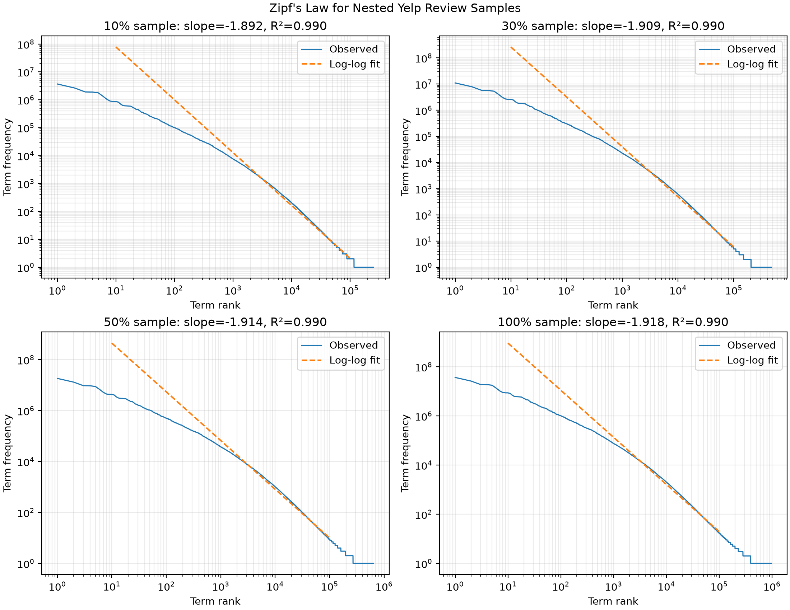
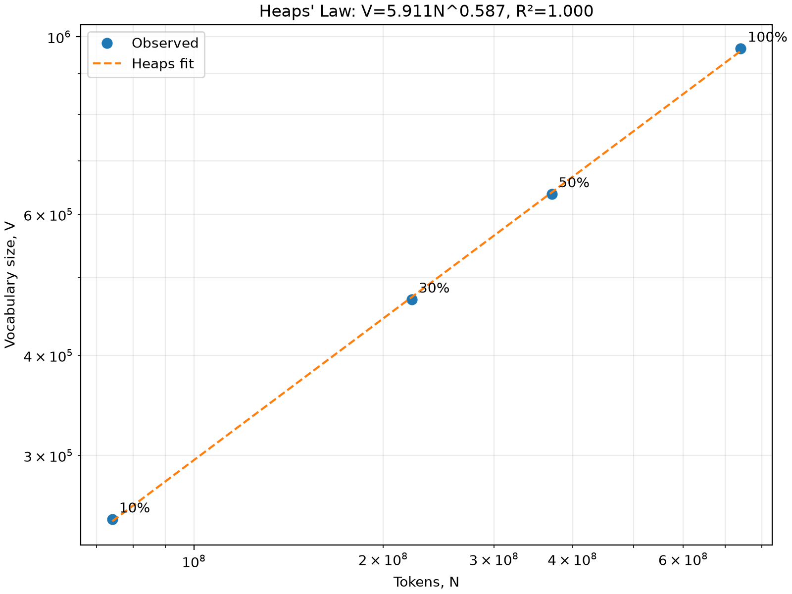

# 3.2 Dataset Analysis: Empirics and Custom Tokenization

All results in this section use the complete `review.json` collection of 6,990,280 reviews. To make the 10%, 30%, 50% and 100% experiments reproducible and nested, each review was assigned a value in [0,1] from the first 32 bits of `SHA-256(review_id)`. Reviews below thresholds 0.10, 0.30 and 0.50 form the smaller samples; hence every smaller sample is a subset of every larger one. The observed proportions (10.011%, 30.013% and 50.051%) are close to their targets. Unlike position-based sampling, this rule is independent of JSON file order and gives every tokenizer exactly the same reviews.

## 3.2.1 Validating Zipf's Law and Heaps' Law

### Method

For each nested sample, the custom tokenizer was applied to every review and term frequencies were accumulated. For Zipf's Law, terms were sorted by decreasing frequency and assigned ranks starting at one. We fitted

`log f(r) = a + b log r`,

where `f(r)` is the frequency at rank `r` and `b` is the empirical Zipf slope. The most frequent few words and the rare-word tail are known to deviate from a single power law, so we report both a head fit (ranks 10-100) and a broad fit (ranks 10-100,000). This avoids presenting a selectively chosen fit as if it described the entire vocabulary.

For Heaps' Law, the observed token count `N` and vocabulary size `V` at the four sample sizes were fitted after logarithmic transformation:

`log V = log k + beta log N`, equivalent to `V = kN^beta`.

### Zipf results



**Figure 1.** Log-log rank-frequency distributions. The orange dashed line is the deliberately broad ranks 10-100,000 fit; its mismatch at the head makes the long-tail deviation visible rather than hiding it.

| Sample | Reviews | Tokens, N | Vocabulary, V | Head slope (10-100) | Broad slope (10-100k) | Broad R2 |
|---|---:|---:|---:|---:|---:|---:|
| 10% | 699,812 | 74,141,451 | 249,617 | -0.972 | -1.892 | 0.990 |
| 30% | 2,098,001 | 222,074,217 | 469,701 | -0.972 | -1.909 | 0.990 |
| 50% | 3,498,737 | 370,658,658 | 635,873 | -0.972 | -1.914 | 0.990 |
| 100% | 6,990,280 | 740,553,186 | 966,439 | -0.971 | -1.918 | 0.990 |

The head slopes are stable across sample sizes and close to the classical Zipf exponent of -1, empirically supporting Zipf-like behaviour among common terms. A single exponent does not describe the complete collection: the curve bends in the long tail and the broad fit becomes much steeper (about -1.9). The custom tokenizer retains meaningful but often unique URLs, emoji and hyphenated expressions, while spelling mistakes and rare names also add singleton types. These effects make the rare-word region fall faster than the head. The high broad-fit R2 should therefore not be interpreted as proof of one perfect power law; the visual residual pattern shows systematic curvature.

### Heaps results



**Figure 2.** Observed vocabulary sizes and the fitted Heaps curve.

The fitted model was

`V = 5.911 N^0.587`, with `R2 = 0.9998`.

The exponent `beta = 0.587` lies between zero and one, as expected for sublinear vocabulary growth: doubling the number of tokens increases the predicted vocabulary by about `2^0.587 = 1.50`, not by a factor of two. Vocabulary increased from 249,617 types at 10% to 966,439 at 100%, while lexical diversity `V/N` fell from 0.00337 to 0.00131 because common terms are repeatedly observed as the corpus grows. The near-perfect R2 is encouraging but is based on only four nested points, so it describes this dataset and tokenizer rather than establishing a universal growth law.

## 3.2.2 The Custom Tokenizer Challenge

### Design and rationale

Whitespace tokenization leaves punctuation attached, whereas WordPunct aggressively separates punctuation from words. Both behaviours are problematic for Yelp text. We implemented a Unicode-aware tokenizer with the third-party `regex` package and the following explicit policy:

- normalize Unicode compatibility characters and curly apostrophes;
- case-fold ordinary tokens to reduce case-only vocabulary duplication;
- preserve contractions such as `don't` and hyphenated expressions such as `the-best-food`;
- preserve emoji, including skin-tone and zero-width-joiner sequences;
- preserve URLs, email addresses, prices, decimals and percentages;
- keep runs of `!` and `?` because they carry emphasis, while discarding other standalone punctuation.

The main tokenizer is a single ordered regular expression; ordering ensures that URLs and prices are captured before the more general word and punctuation alternatives:

```python
TOKEN_PATTERN = regex.compile(r"""
    https?://[^\s<>()]+(?<![.,!?;:]) |
    [\w.+-]+@[\w.-]+\.[A-Za-z]{2,} |
    [$£€¥]?\d+(?:[.,]\d+)*(?:%|[A-Za-z]+)? |
    \p{Regional_Indicator}{2} |
    \p{Extended_Pictographic}(?:\uFE0F|\p{Emoji_Modifier})?
        (?:\u200D\p{Extended_Pictographic}
        (?:\uFE0F|\p{Emoji_Modifier})?)* |
    [\p{L}\p{M}]+(?:'[\p{L}\p{M}]+)*
        (?:-[\p{L}\p{M}]+(?:'[\p{L}\p{M}]+)*)* |
    [!?]+
""", regex.VERBOSE | regex.IGNORECASE)
```

### Quantitative and qualitative comparison

All three tokenizers processed the same 6,990,280 reviews. For the quantitative comparison, Unicode normalization and case-folding were also applied before the two NLTK baselines so that the comparison focused primarily on segmentation rather than capitalization.

| Tokenizer | Total tokens | Tokens/review | Vocabulary | Hapax types | Hapax share | Time |
|---|---:|---:|---:|---:|---:|---:|
| Custom regex | 740,553,186 | 105.94 | 966,439 | 571,714 | 59.16% | 11.45 min |
| Whitespace | 732,416,358 | 104.78 | 3,566,179 | 2,378,155 | 66.69% | 4.71 min |
| WordPunct | 856,627,343 | 122.55 | 650,566 | 349,813 | 53.77% | 5.48 min |

Whitespace produced 3.69 times the custom vocabulary because surface variants such as `service`, `service!`, `service!!` and `service.` remain different types. Its very high hapax share supports this interpretation. WordPunct produced 15.7% more tokens than the custom tokenizer because it splits contractions, hyphens, prices and punctuation into several pieces; this reduces vocabulary size but loses meaningful units. The custom tokenizer is approximately twice as slow as the baselines, which is the cost of Unicode-aware matching and more complex alternatives, but it still processed the full corpus in under twelve minutes on the development machine.

Example input: `The-best-food wasn't cheap 😊! Dinner was $25.50.`

| Tokenizer | Output |
|---|---|
| Custom | `the-best-food`, `wasn't`, `cheap`, `😊`, `!`, `dinner`, `was`, `$25.50` |
| Whitespace | `The-best-food`, `wasn't`, `cheap`, `😊!`, `Dinner`, `was`, `$25.50.` |
| WordPunct | `The`, `-`, `best`, `-`, `food`, `wasn`, `'`, `t`, `cheap`, `😊!`, `Dinner`, `was`, `$`, `25`, `.`, `50`, `.` |

The custom output better matches the intended semantic units, but the policy is not universally optimal. Keeping a complete URL as one token creates rare vocabulary types; retaining a hyphenated form means a query for `gluten free` does not automatically match `gluten-free`; and repeated punctuation remains a distinct emphasis token. These are documented design choices rather than claims that one tokenizer is best for every downstream task.

## Third-party software and references to include

Python `regex` (Unicode regular expressions), NLTK `WhitespaceTokenizer` and `WordPunctTokenizer`, NumPy (regression and arrays), and Matplotlib (figures). The final bibliography should include the original Zipf and Heaps references and the NLTK/software references used by the group.
