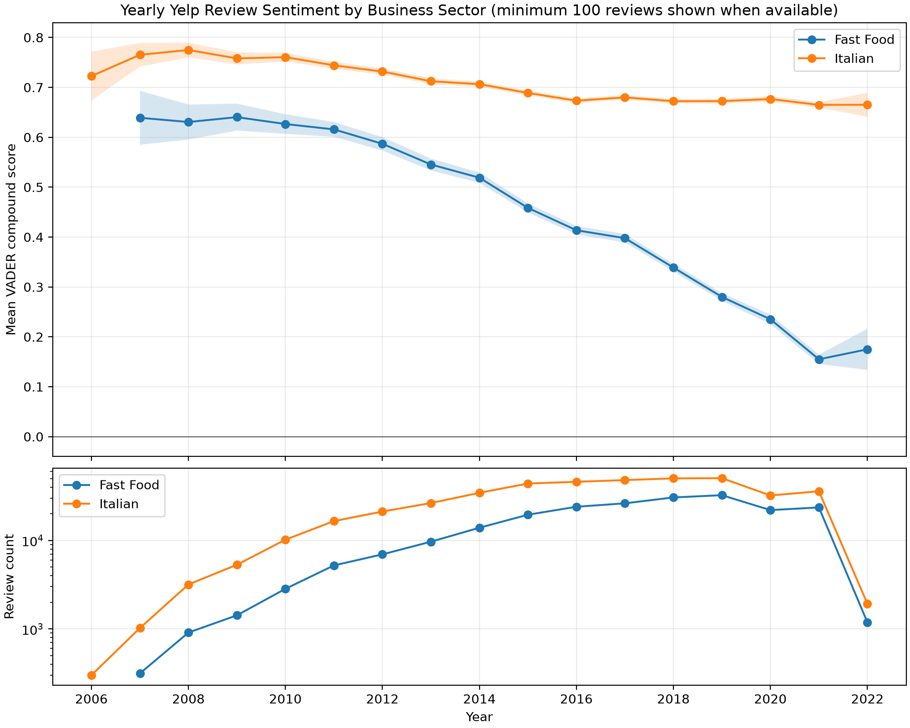
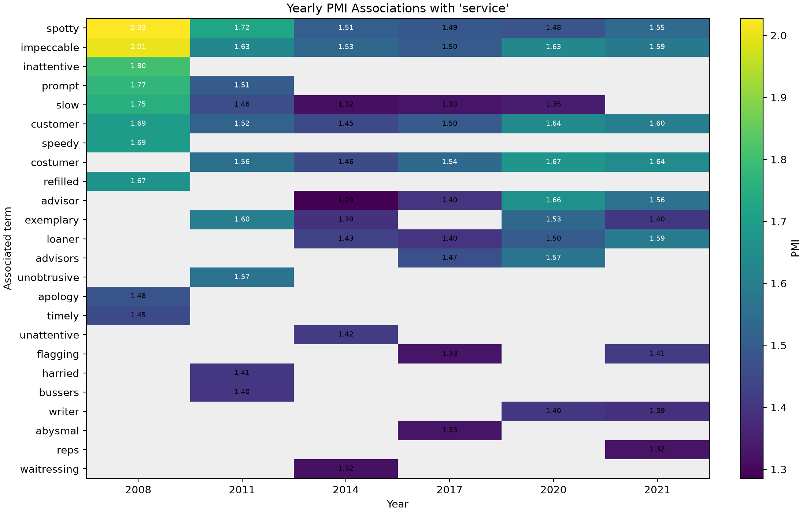

# 3.4 Trend Analysis: Lexicons and Temporal Associations

The Yelp review dates span 2005-2022. The 2022 data cover only part of that year, so 2022 is shown for completeness but is not treated as directly comparable to complete calendar years.

## 3.4.1 Lexicon-Based Sentiment Mining

### Sector definition and method

We compared the assignment's example sectors, **Italian** and **Fast Food**. `business.json` categories were split on commas and matched case-insensitively by exact category name, then joined to `review.json` through `business_id`. Exact matching avoids false substring matches. The mapping contained 4,320 Italian businesses and 6,219 Fast Food businesses; 253 businesses carrying both labels were excluded to keep the groups disjoint. The final analysis contained 427,081 Italian and 220,731 Fast Food reviews.

VADER was chosen because it is a classic rule- and lexicon-based method designed for informal text. We scored the original review text rather than custom-tokenized text because VADER uses capitalization, negation, punctuation and emoji as sentiment cues. Its compound score lies in [-1,1]. Following VADER's conventional thresholds, scores at least 0.05 were labelled positive, scores at most -0.05 negative, and the remainder neutral. For each sector-year we calculated the mean compound score, sentiment proportions, mean star rating, standard error and a 95% confidence interval. Years with fewer than 100 reviews were omitted from the main figure but retained in the CSV output.

```python
compound = analyzer.polarity_scores(review["text"])["compound"]
bucket = aggregates[(sector, year)]
bucket["count"] += 1
bucket["sum_compound"] += compound
bucket["sum_compound_squared"] += compound * compound
```

### Results



**Figure 3.** Mean compound sentiment with 95% confidence intervals (top) and yearly review counts on a log scale (bottom). Years below 100 reviews per sector are not shown in the figure.

| Sector/year | Reviews | Mean compound | 95% CI | Positive | Negative | Mean stars |
|---|---:|---:|---:|---:|---:|---:|
| Italian, 2007 | 1,023 | 0.765 | [0.742, 0.789] | 92.7% | 6.4% | 3.88 |
| Italian, 2015 | 43,890 | 0.689 | [0.684, 0.694] | 87.2% | 11.7% | 3.77 |
| Italian, 2021 | 35,877 | 0.665 | [0.659, 0.670] | 85.7% | 13.2% | 3.91 |
| Fast Food, 2007 | 314 | 0.639 | [0.585, 0.693] | 86.6% | 11.5% | 3.72 |
| Fast Food, 2015 | 19,497 | 0.458 | [0.449, 0.468] | 74.4% | 23.5% | 3.24 |
| Fast Food, 2021 | 23,564 | 0.155 | [0.146, 0.164] | 55.3% | 41.3% | 2.53 |

Italian reviews remained strongly positive, with a moderate decline from 0.765 in 2007 to 0.665 in 2021. Fast Food sentiment declined much more sharply, from 0.639 to 0.155 over the same endpoints; its negative-review share rose from 11.5% to 41.3%. The average Fast Food star rating also fell from 3.72 to 2.53, providing an independent directional sanity check. From 2010 onward the confidence intervals are narrow because the yearly sample sizes are large, and the Italian/Fast Food intervals do not overlap. This supports a real difference in the reviews represented in the dataset, but not a causal claim that the sector itself produced the decline: geographic coverage, the businesses contributing reviews and the mix of chains may also change over time.

### Limitations

- **Sarcasm and irony.** VADER mainly evaluates surface polarity. `Great service - I only waited 45 minutes` contains a positive lexicon word and may be scored positively although it is a complaint.
- **Mixed and long reviews.** A review can praise food while criticizing service; one compound score hides aspect-level disagreement and can become positive as positive words accumulate.
- **Scores are not probabilities.** A compound score of 0.66 does not mean that a review is 66% positive, and mean compound values should be interpreted comparatively.
- **Selection and composition.** Reviews are weighted equally, so frequently reviewed businesses dominate sector means. Categories are treated as fixed metadata rather than historical labels.
- **Temporal coverage.** Early years have small samples, and 2022 is incomplete. Lexicon and language usage may also change over time.

## 3.4.2 Term Co-occurrence Drift

### PMI definition and rationale

The target aspect was **service**. We used review-level binary co-occurrence: a candidate word co-occurs with `service` when both appear at least once in the same review. Binary document counts prevent a long review repeating a word many times from dominating the statistic. After custom tokenization, candidates were restricted to alphabetic tokens of at least three characters and common English stopwords were removed.

For year `y`, with `N_y` reviews, document frequencies `df_y(service)` and `df_y(w)`, and joint document frequency `df_y(service,w)`, we calculated

`PMI_y(service,w) = log2[ df_y(service,w) N_y / (df_y(service) df_y(w)) ]`.

PMI is biased toward rare events, so a candidate had to appear in at least 50 reviews, co-occur with `service` in at least 10 reviews, and belong to a year containing at least 50 target reviews. The ten highest-PMI candidates were retained for every eligible year. These thresholds were fixed before ranking; the CSV also records all supporting counts so that a high score with weak support can be identified.

```python
pmi = math.log2(
    (cooccurring_reviews * total_reviews)
    / (service_reviews * term_reviews)
)
```

### Results



**Figure 4.** PMI of the top associations with `service` for representative years. Grey cells mean that a term was not in that year's top ten; the complete CSV contains ten ranked terms for every year from 2005 to 2022.

| Year | Leading associations (PMI; co-occurring reviews) |
|---:|---|
| 2005 | `excellent` (1.78; 22), `prices` (1.14; 16), `menu` (1.04; 24) |
| 2006 | `slow` (2.33; 47), `attentive` (1.51; 28), `waiter` (1.42; 25) |
| 2010 | `spotty` (1.81; 199), `impeccable` (1.74; 337), `prompt` (1.58; 752) |
| 2015 | `impeccable` (1.53; 1,643), `advisors` (1.51; 53), `costumer` (1.51; 292) |
| 2020 | `costumer` (1.67; 345), `advisor` (1.66; 273), `customer` (1.64; 31,133) |
| 2021 | `costumer` (1.64; 373), `customer` (1.60; 32,525), `loaner` (1.59; 213) |

The earliest associations are mainly restaurant-service evaluations (`slow`, `attentive`, `waiter`, `fast`). By 2010, general service-quality adjectives (`spotty`, `impeccable`, `prompt`) dominate. Later years retain `customer` and `impeccable` but increasingly include `advisor`, `advisors` and `loaner`, terms common in automotive and professional-service reviews. This is evidence of association drift around the word `service`, although it may reflect changing business-domain composition as well as a change in the word's meaning. The persistent misspelling `costumer` is not a computation error: it passes the tokenizer as an ordinary word and illustrates the noise present in user-generated text.

### Limitations

- Review-level co-occurrence is broad: two terms at opposite ends of a long review count as associated. A sentence or fixed-window definition would be more local but would answer a different question.
- PMI favours rare terms. Frequency thresholds reduce but do not remove this bias; early-year terms supported by only 10-50 joint reviews are less reliable than later associations supported by thousands.
- No stemming or spelling correction was applied, so `advisor`/`advisors` and `customer`/`costumer` remain separate types.
- The analysis combines all Yelp sectors. Consequently, apparent semantic drift can be caused by changes in the mixture of restaurants, automotive businesses and other services.
- The 2022 data are partial and should not be interpreted as a complete annual trend.

## Third-party software and references to include

VADER Sentiment (`vaderSentiment` implementation), Python `regex`, NumPy and Matplotlib. The final bibliography should cite Hutto and Gilbert's VADER paper and a standard reference for pointwise mutual information.
